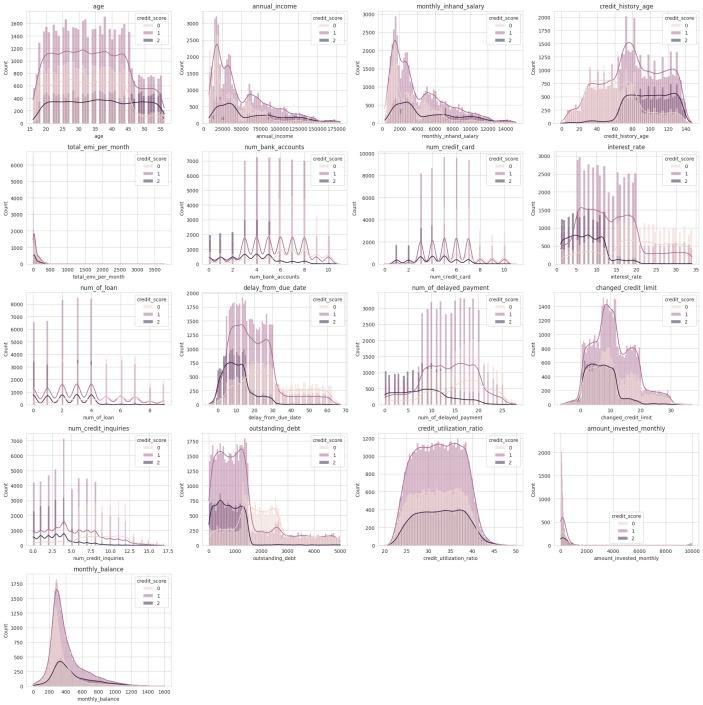
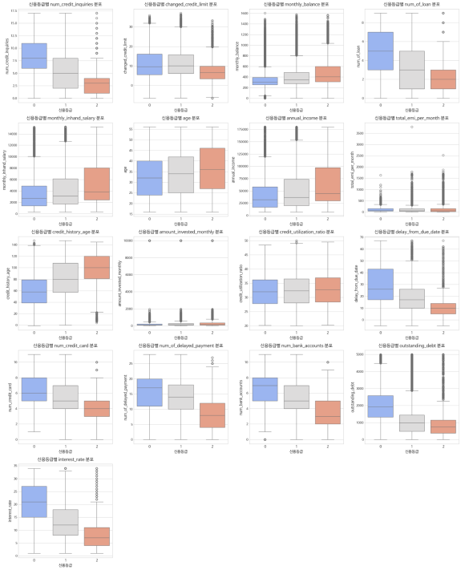
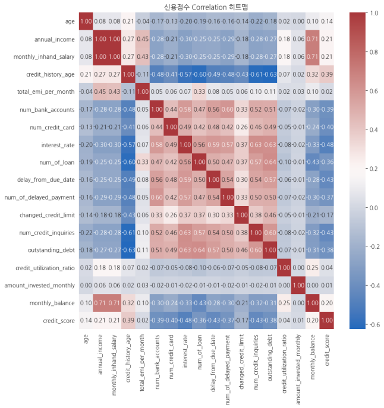
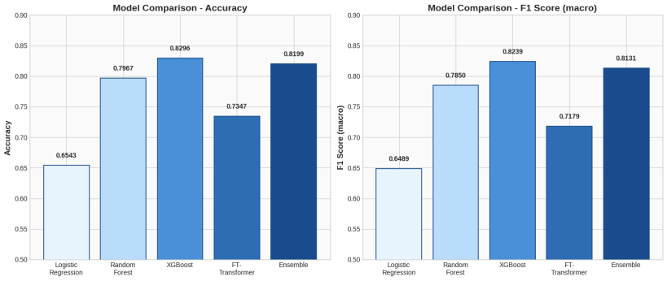

# Credit Score Classification and Overdue Days Regression
 
- 신용정보 데이터셋을 이용한 신용점수 Classification과 연체일수 Regression
- 이 문서는 **EDA**와 **Task 1: Classification** 파트를 다룹니다. Task 2: Regression는 아래 별도 섹션을 참고해 주세요.
 

 
## 📌 문제 정의
 
금융기관은 고객의 대출 상환 가능성을 정확히 예측해 신용 리스크를 줄이고, 고객에게 맞춤형 금융 서비스를 제공해야 합니다. 하지만 고객의 재무 상황, 소득 구조, 지출 습관, 상환 이력은 매우 다양해서 전통적인 점수 기반 신용평가만으로는 연체 위험을 충분히 반영하기 어렵습니다.
 
본 프로젝트는 두 가지 Task로 구성됩니다.
 
| Task | 목표 | 타깃 변수 |
| ---- | ---- | -------- |
| **Task 1: Classification** | 고객 금융 데이터로 신용점수를 3단계로 분류 | `credit_score` <br> (0: Poor, 1: Standard, 2: Good) |
| Task 2: Regression | 연체 일수를 예측해 분류 결과를 보완 | `delay_from_due_date` |
 
EDA 및 Task에 관한 문서는 [Proposal](<reports/01_Proposal report.pdf>) · [Progress](<reports/02_Progress report.pdf>) · [Final](<reports/03_Final report.pdf>) 에서 빠르게 자세히 확인해 보실 수 있습니다.
 
## 📁 프로젝트 구조
 
```
📁 Credit-Risk-Assessment-using-Classification-and-Regression/
├── 📁 data/
│   ├── credit_score_train.csv          # 정제된 원본 데이터 (96,696 × 28)
│   └── preprocessed_data.pkl           # 인코딩 + 8:1:1 분할 완료 데이터
├── 📁 models/
│   └── 📁 01_classification/
│       └── best_lr_model.pkl           # Logistic Regression (+ scaler)
├── 📁 notebooks/
│   ├── 📁 01_eda/
│   │   └── eda.ipynb                   # EDA + 전처리 + 데이터 분할
│   ├── 📁 02_classification/
│   │   ├── logistic_regression.ipynb
│   │   ├── random_forest.ipynb
│   │   ├── xgboost_model.ipynb
│   │   ├── ft_transformer.ipynb
│   │   └── ensemble_model.ipynb
│   └── 📁 03_regression/
├── 📁 images/                          # README용 시각화 자료
├── 📁 reports/
│   ├── 01_Proposal report.pdf
│   ├── 02_Progress report.pdf
│   └── 03_Final report.pdf
└── README.md
```
 
- `best_rf_model.pkl`, `best_xgb_model.pkl`, `best_ft_model.pkl`은 GitHub 용량 제한(100MB)을 초과하여 저장소에서 제외되었습니다.
- 노트북을 실행하면 다시 생성됩니다. 


## 📈 데이터셋
 
#### [Kaggle – Credit Score Classification](https://www.kaggle.com/datasets/parisrohan/credit-score-classification)
#### 규모
- 96,696개 행 × 28개 열
- 고객 12,087명 × 1~8월 월별 기록

#### 주요 변수
- 인구통계(`age`, `occupation`)
- 재무지표(`annual_income`, `monthly_inhand_salary`, `outstanding_debt`, `total_emi_per_month`)
- 신용/상환 패턴(`credit_history_age`, `credit_utilization_ratio`, `num_credit_inquiries`, `num_of_delayed_payment`, `payment_behaviour`, `credit_mix`) 등

 
## 🔍 EDA (`notebooks/01_eda/eda.ipynb`)
 
### 1. 타깃 변수 분포
 
| Credit Score | 비율 |
| ------------ | :--: |
| 0: Poor | 28.4% |
| 1: Standard | 53.3% |
| 2: Good | 18.3% |
 
Standard 클래스가 절반 이상을 차지하는 **불균형 분포**입니다. 이 때문에 모든 모델에서 데이터 분할 시 `stratify`를 적용했고, 평가지표로 Accuracy와 함께 **F1 Score (macro)** 를 사용했습니다.
 
### 2. 변수 분포 및 이상치 탐색
 
수치형 변수 13개를 `credit_score`별 히스토그램과 박스플롯으로 시각화했습니다.
 
<p align="center">
  
  
</p>
<p align="center"><sub>좌: 신용점수별 변수 분포 히스토그램 · 우: 신용점수별 박스플롯</sub></p>

- 대부분의 변수에서 Poor(0)와 Good(2)의 분포가 뚜렷하게 갈리는 지점이 있어, 해당 변수들이 신용등급 분류에 유의미한 신호가 될 수 있음을 확인했습니다.
- **Poor(0)** 그룹은 `num_of_loan`, `num_credit_card`, `num_of_delayed_payment`, `total_emi_per_month`, `delay_from_due_date`가 높고 `annual_income`, `monthly_balance`가 낮아 재무 안정성이 낮았습니다.
- **Standard(1)** 그룹은 두 그룹 사이의 중간적 특성을 보였습니다.
- **Good(2)** 그룹은 소득과 잔액이 높고 신용 이력이 길며, 부채와 연체 수준이 낮았습니다.
- 이상치는 대부분 상향(큰 값 쪽)으로 나타났고, 하향 이상치는 거의 없었습니다.
종합하면, 신용등급이 낮을수록 부채와 연체가 늘고 높을수록 안정적인 금융 패턴을 보였습니다.
 
### 3. 변수 간 상관관계
 
수치형 변수 전체의 상관계수 히트맵에서 다음과 같은 관계가 두드러졌습니다.
 
<p align="center">
  
</p>

| 변수 쌍 | 상관계수 | 해석 |
| ------- | :------: | ---- |
| `monthly_inhand_salary` – `monthly_balance` | **+0.71** | 소득이 높을수록 월말 잔액이 많음 |
| `credit_history_age` – `num_credit_inquiries` | **−0.61** | 신용 이력이 길수록 신용 조회가 적음 |
| `delay_from_due_date` – `num_of_delayed_payment` | **+0.57** | 연체 횟수가 많을수록 연체일수도 김 |
 
### 4. 데이터 전처리
 
원본 Kaggle 데이터에는 음수 나이, `"24_"`처럼 문자가 섞인 숫자, 범주형 변수의 결측치 등 품질 문제가 있었습니다. 데이터가 고객별 1~8월 기록으로 구성된다는 점을 활용해, 같은 고객의 다른 월 값을 참고하는 **문맥 기반 Imputation**으로 결측치를 보정했고, 정규식으로 불순 문자를 제거한 뒤 수치형으로 변환했습니다.
 
이후 모델 입력을 위해 다음과 같이 인코딩했습니다.
 
| 변수 | 처리 방법 |
| ---- | --------- |
| `id`, `customer_id`, `name`, `ssn` | 식별자이므로 제거 |
| `month` | 1~8 정수로 매핑 |
| `occupation` | One-Hot Encoding (15개 직업) |
| `credit_mix` | 순서형 매핑 (Bad 0 / Standard 1 / Good 2) |
| `payment_of_min_amount` | 이진 매핑 (Yes 1 / No 0) |
| `payment_behaviour` | 지출 수준 × 결제 규모 기준 순서형 매핑 (1~6) |
| `type_of_loan` | 10개 대출 유형별 보유 개수 컬럼으로 분해 |
 
최종적으로 **45개 피처**가 만들어졌고, Train / Validation / Test를 **8 : 1 : 1** (77,366 / 9,660 / 9,670)로 층화 분할해 `data/preprocessed_data.pkl`에 저장했습니다. 분류 모델 학습 시에는 Train과 Validation을 합쳐(87,026건) 사용하고, Test 9,670건으로 최종 평가했습니다.
 
 
## 🤖 Task 1: Classification (`notebooks/02_classification/`)
 
모든 모델은 같은 Test set(9,670건)으로 평가해 공정하게 비교했다.
모델마다 기본 버전을 먼저 만들고, 성능 개선 기법을 더해 비교했다.
 
### 한눈에 보기
 
| 모델 | 입력 피처 | 핵심 개선 기법 | F1 (macro) |
|---|---|---|---|
| Logistic Regression | 원본 45개 + 스케일링 | L1 정규화, class_weight | 0.625 → 0.649 |
| Random Forest | 파생 포함 상위 20개 | 피처 엔지니어링, Feature Selection | 0.764 → 0.785 |
| **XGBoost** | 원본 45개 | L1/L2 정규화, Optuna | 0.810 → **0.824** |
| FT-Transformer | 원본 45개 + 스케일링 | Label Smoothing, LR 스케줄링 | 0.682 → 0.718 |
| Ensemble | 모델별 입력 그대로 | Soft Voting 가중치 탐색 | 0.800 → 0.813 |
 
모든 모델에 Optuna 하이퍼파라미터 튜닝을 적용했다.
튜닝은 샘플 데이터(약 30%)로 진행하고, 찾은 파라미터로 전체 데이터를 다시 학습했다.
 
### 1. Logistic Regression
 
선형 모델로 기준(baseline) 성능을 확인했다.
 
| 항목 | 내용 |
|---|---|
| 튜닝 대상 | `C`, `penalty`, `class_weight` |
| 최적값 | L1, `C` ≈ 0.003, `balanced` |
| 결과 | Acc 0.655 → 0.654, F1 0.625 → 0.649 |
 
- `class_weight='balanced'`로 Good 재현율이 0.61에서 0.85로 올랐다.
- Good 정밀도는 0.50에 그쳤다. 선형 결정 경계로는 Standard와 Good을 잘 구분하지 못했다.

### 2. Random Forest
 
결정 트리 여러 개를 결합해 변수 간 비선형 관계와 상호작용을 학습했다.
피처 엔지니어링, Feature Selection, 튜닝 세 단계로 성능을 높였다.
 
**① 피처 엔지니어링** 
- 파생 변수 12개를 추가했다 (45개 → 56개).
 
| 유형 | 파생 변수 |
|---|---|
| 비율 | `debt_to_income`, `emi_to_income`, `balance_to_income`, `invest_to_income` |
| 신용 복합 | `credit_load`, `delay_severity`, `loan_per_account` |
| 신용 이력 대비 | `inquiries_per_year`, `accounts_per_year` |
| 지불 부담 | `payment_burden` |
| 로그 변환 | `log_income`, `log_debt` |
 
`payment_burden`은 월 EMI에 (부채 × 이자율)을 더한 값이다.
 
**② Feature Selection** 
- RF 피처 중요도 상위 20개만 남겼다.
- 상위 5개는 `credit_mix`, `log_debt`, `outstanding_debt`, `interest_rate`, `payment_burden`이다.
- 파생 변수가 상위권에 다수 들어갔다.
 
**③ 튜닝**
 
| 항목 | 내용 |
|---|---|
| 튜닝 대상 | `n_estimators`, `max_depth`, `min_samples_split`, `min_samples_leaf`, `class_weight` |
| 최적값 | 100, 20, 2, 1, `None` |
| 결과 | Acc 0.776 → 0.797, F1 0.764 → 0.785 |
 
### 3. XGBoost
 
잔여 오차를 순차적으로 보정하는 Boosting 모델이다. 최종 모델로 채택했다.
 
| 항목 | 내용 |
|---|---|
| 튜닝 대상 | 학습률, 트리 깊이, `subsample`, `colsample_bytree`, `reg_alpha`(L1), `reg_lambda`(L2) |
| 최적값 | `n_estimators=200`, `max_depth=10`, `learning_rate=0.1`, `subsample=0.7`, `colsample_bytree=0.7`, `reg_alpha=0`, `reg_lambda=1` |
| 결과 | Acc 0.818 → 0.830, F1 0.810 → 0.824 |
 
RF와 같은 피처 엔지니어링 + Feature Selection도 실험했지만 성능이 떨어졌다.
 
| 입력 | Accuracy |
|---|---|
| 원본 45개 + 튜닝 | **0.830** |
| 파생 포함 상위 20개 | 0.813 |
| 파생 포함 상위 20개 + 튜닝 | 0.804 |
 
XGBoost는 피처 간 상호작용을 스스로 학습하므로 원본 피처가 더 유리했다.
 
### 4. FT-Transformer
 
표형(tabular) 데이터용 Transformer 모델이다.
`pytorch-tabular` 의존성 문제로 순수 PyTorch로 직접 구현했다.
 
**구조**: Feature Tokenizer → `[CLS]` 토큰 + Positional Embedding → Transformer Encoder (GELU) → `[CLS]` 출력으로 분류
 
| 항목 | 내용 |
|---|---|
| 학습 기법 | Label Smoothing, Cosine Annealing, Gradient Clipping, AdamW, Early Stopping |
| 튜닝 대상 | `embed_dim`, `num_heads`, `num_layers`, `ff_dim`, dropout, 학습률, 배치 크기, label smoothing |
| 최적값 | 64, 4, 4, 64, 0.11, 1e-3, 1024, 0.12 |
| 결과 | Acc 0.707 → 0.735, F1 0.682 → 0.718 |
 
### 5. Ensemble (Soft Voting)
 
RF, XGBoost, FT-Transformer의 클래스별 예측 확률을 가중 평균해 최종 클래스를 정했다.
모델마다 입력을 다르게 둔 것이 앙상블의 다양성을 높였다.
 
| 모델 | 입력 |
|---|---|
| RF | 파생 포함 상위 20개 |
| XGBoost | 원본 45개 |
| FT-Transformer | 원본 45개 + `StandardScaler` |
 
가중치는 0.1 단위 Grid Search로 탐색했다.
 
| 가중치 (RF / XGB / FT) | Accuracy | F1 (macro) |
|---|---|---|
| 0.3 / 0.35 / 0.35 (초기) | 0.808 | 0.800 |
| **0.3 / 0.5 / 0.2 (최적)** | **0.820** | **0.813** |
 
## 📊 성능 비교 (Test set, n = 9,670)
 
<p align="center">
  
</p>

| Model | 기본 Accuracy | 기본 F1 (macro) | 개선 후 Accuracy | 개선 후 F1 (macro) |
| ----- | :-----------: | :-------------: | :--------------: | :----------------: |
| Logistic Regression | 0.6552 | 0.6254 | 0.6543 | 0.6489 |
| Random Forest | 0.7764 | 0.7642 | 0.7967 | 0.7850 |
| **🏆 XGBoost** | 0.8176 | 0.8104 | **0.8296** | **0.8239** |
| FT-Transformer | 0.7073 | 0.6818 | 0.7347 | 0.7179 |
| Ensemble (Soft Voting) | 0.8084 | 0.7997 | 0.8199 | 0.8131 |
 
#### 최종 모델 XGBoost의 클래스별 성능
 
| Class | Precision | Recall | F1 |
| ----- | :-------: | :----: | :-: |
| Poor (0) | 0.81 | 0.83 | 0.82 |
| Standard (1) | 0.85 | 0.83 | 0.84 |
| Good (2) | 0.80 | 0.82 | 0.81 |
 
세 클래스 모두 F1 0.8 이상으로, 소수 클래스인 Good에서도 균형 잡힌 성능을 보였습니다.
 
#### 결과 분석
 
1. **XGBoost가 전체 최고 성능** (Accuracy 82.96%, F1 82.39%)을 기록했습니다. Boosting의 순차적 오차 보정과 정규화가 정형 데이터의 비선형 패턴 학습에 효과적이었습니다.
2. **앙상블이 XGBoost 단일 모델보다 낮았습니다** (81.99%). 성능이 크게 낮은 FT-Transformer가 포함되면서 전체를 끌어내린 것으로, Soft Voting에서는 참여 모델 간 성능 균형이 중요하다는 점을 보여줍니다.
3. **FT-Transformer는 트리 모델보다 약 6~10%p 낮았습니다.** 피처 간 순서가 의미 없고 분포가 이질적인 정형 데이터에서는 트리 모델의 분기 기반 학습이 더 유리하다는 기존 연구 결과와 일치합니다.
4. **피처 엔지니어링 효과는 모델마다 달랐습니다.** Random Forest는 파생 변수와 Feature Selection으로 약 2%p 향상된 반면, XGBoost는 원본 피처에서 더 좋은 성능을 보였습니다.
5. **Logistic Regression**은 선형 모델의 한계로, 특히 Standard와 Good 사이 경계에서 오분류가 많았습니다.


 
 
## 🚀 실행 방법
 
#### 환경 설정
 
```bash
pip install pandas numpy scikit-learn xgboost torch optuna matplotlib seaborn
```
 
#### 실행 순서
 
1. `notebooks/01_eda/eda.ipynb`: EDA, 전처리, 데이터 분할 후 `preprocessed_data.pkl` 생성
2. `notebooks/02_classification/` 의 `logistic_regression` → `random_forest` → `xgboost_model` → `ft_transformer` 노트북 실행 (각 모델 `.pkl` 저장)
3. `notebooks/02_classification/ensemble_model.ipynb`: 저장된 RF, XGBoost, FT 모델을 불러와 앙상블
4. 노트북은 Google Colab + Google Drive 경로 기준으로 작성되어 있으므로, 로컬에서 실행할 때는 `LOAD_PATH` / `SAVE_PATH`를 수정해 주세요.
 
#### 전처리 데이터 로드
 
```python
import pickle
 
with open('data/preprocessed_data.pkl', 'rb') as f:
    data_dict = pickle.load(f)
 
X_train, y_train = data_dict['X_train_clf'], data_dict['y_train_clf']
X_val,   y_val   = data_dict['X_val_clf'],   data_dict['y_val_clf']
X_test,  y_test  = data_dict['X_test_clf'],  data_dict['y_test_clf']
```
 
#### 저장된 Logistic Regression 모델로 예측
 
```python
with open('models/01_classification/best_lr_model.pkl', 'rb') as f:
    lr_dict = pickle.load(f)
 
model, scaler = lr_dict['model'], lr_dict['scaler']
predictions = model.predict(scaler.transform(X_test))
```
 
 
## 📝 Notes
 
- Google Colab 환경에서 개발했으며, FT-Transformer는 GPU 환경을 권장합니다.
- 재현성을 위해 `random_state=42`로 시드를 고정했습니다.
- 자세한 분석 과정은 [Progress report](<reports/02_Progress report.pdf>)와 [Final report](<reports/03_Final report.pdf>)를 참고해 주세요.

 
## 👤 Author
 
- [@hayeon7898](https://github.com/hayeon7898) : EDA & Classification
- [@seoyuncho](https://github.com/seoyuncho) : EDA & Regression
